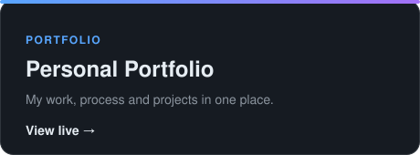

 

 

## 👋 About Me

I turn creative ideas and design inspiration into modern, responsive, and interactive web experiences. I combine design research, UI exploration, and AI-assisted development to turn concepts into functional websites.

- 💻 Build modern and responsive websites
- 🎨 Explore UI/UX designs and creative layouts
- 🤖 Use AI-powered tools to move faster
- ✨ Turn design references into functional web experiences
- 🔍 Explore SEO and website optimization
- 🚀 Building my creative agency, **Omnicraft**

 

## 🛠️ Tools I Use

  
  
  
  
  
  
  

  
  
  

  
  
  
  

 

## 🌱 Currently Learning

 

## ⭐ Featured Projects

 

